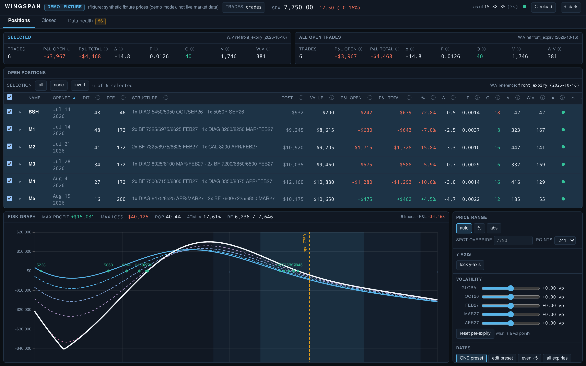
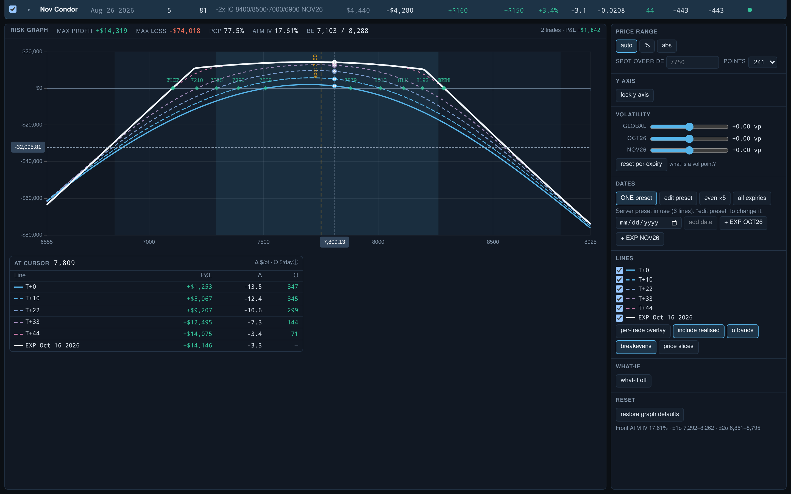

# Wingspan

**SPX options position dashboard & risk analyzer** — parses thinkorswim trade
files and account statements into per-trade positions, prices them with live
(Schwab) or delayed (yfinance) data, and draws an OptionNetExplorer-style risk
graph. Rust core, React front end, one release binary.

> Butterflies have wings; the risk graph spans price.

## Features

- Parses thinkorswim trade files and daily account statements — butterflies,
  verticals, calendars, diagonals, ratio spreads — into per-trade positions,
  with fill prices, fees and executions matched from the statements rather
  than guessed.
- Every trade's DIT/DTE, P&L (open + realized), Greeks and weighted vega,
  toggleable in and out of a selected-subset view with live portfolio totals.
- An OptionNetExplorer-style risk graph: the expiration line plus a T+x
  ladder, breakevens, ±1σ/2σ price bands, a probability-of-profit readout
  and a what-if panel, all driven by the app's own solved IVs so the graph
  and the table always agree.
- Live pricing from Schwab's market-data API, falling back to a Yahoo
  (`yfinance`) bridge, a cached snapshot, or the latest statement's marks —
  each with an honest status pill and per-cell staleness.
- Quantity-only reconciliation against the latest account statement, with
  duplicate/unmatched orders quarantined rather than silently netted, and a
  Data Health tab that shows every warning and how to fix it.
- Closed-trades history with realized P&L, fees, win rate and average days
  held.
- One release binary with the SPA embedded (`--features embed-ui`); dark and
  light themes.

## Quick start

The dashboard is a React SPA embedded into the `wingspan` binary, so build
the SPA once, then build the binary with the `embed-ui` feature:

```bash
export NVM_DIR="$HOME/.nvm" && . "$NVM_DIR/nvm.sh"   # if node is nvm-managed
cd web && npm ci && npm run build && cd ..

# demo mode: bundled anonymised fixtures + synthetic market data, no network
cargo run -p wingspan-server --features embed-ui -- serve --demo
# then open http://127.0.0.1:8787
```

The fixtures are a dated snapshot, so `--demo` values them on their own day
rather than yours and says so on start-up (`demo mode: fixtures at …, valued as
of 2026-08-31`): the DIT and DTE columns are measured from 2026-08-31, not from
today's calendar. `serve --as-of YYYY-MM-DD` moves that date on any run —
`docs/CONFIG.md`.

Point it at your own trades folder (add a live data source per
`docs/SCHWAB.md`/`docs/CONFIG.md` — with none configured the dashboard waits
for a market snapshot rather than showing stale numbers):

```bash
cp wingspan.example.toml wingspan.toml   # edit [trades] root
cargo run -p wingspan-server --features embed-ui -- serve
```

Or skip the config file entirely: the status bar's **Trades** control browses
the folders on the machine running the server and picks the one holding
`Open Trades`/`Closed Trades`/`Daily Trade Statement`, remembering the choice
in the state directory rather than rewriting your `wingspan.toml`
(`docs/CONFIG.md`). When you browse the dashboard from a laptop while the
server runs somewhere else, that control's **On this device** tab reads the
folder in the browser instead and uploads a snapshot of it — the server cannot
see your laptop's disk, so re-sync after you edit a trade file.

Building with `cargo run -p wingspan-server -- serve` (no `--features
embed-ui`) skips the SPA build and serves the API only — useful while
developing the front end against `npm run dev` (Vite on :5173, proxying
`/api` back here), not for browsing the dashboard directly.

## Screenshots

Demo mode, dark theme, the bundled anonymised fixtures:





Regenerate them with `just screenshots`.

## Documentation

- `docs/PLAN.md` — full product/architecture plan
- `docs/API.md` — the frozen HTTP API contract
- `docs/CONFIG.md` — every config key
- `docs/SCHWAB.md` — token file, refresh, API usage
- `docs/DATA-FORMATS.md` — TOS order grammar + statement dialect
- `docs/ARCHITECTURE.md` — crate map + extension points
- `docs/DEPLOY.md` — step-by-step production build + deploy, systemd units
  (system-wide on-boot and per-user)

## Development

```bash
just ci        # redaction guard, fmt, clippy, tests, web typecheck/lint/test/build, Playwright
just e2e       # Playwright against `wingspan serve --demo` (real binary, embedded SPA)
just release   # single binary with the SPA embedded
```

Every web recipe depends on `web-deps`, which runs `npm ci` only when
`web/node_modules` is missing or older than `web/package-lock.json` — so a
fresh clone needs no manual install step, and a warm tree runs offline with
no reinstall. `just web-install` forces the clean reinstall CI does.

`just e2e` reuses an already-running local server on `:8787`/`:8789` instead
of rebuilding it (see the `reuseExistingServer` note in
`web/playwright.config.ts`) — kill any leftover `wingspan serve --demo`
process before re-running the suite after a Rust or SPA source change, or
it will silently test the old binary.
