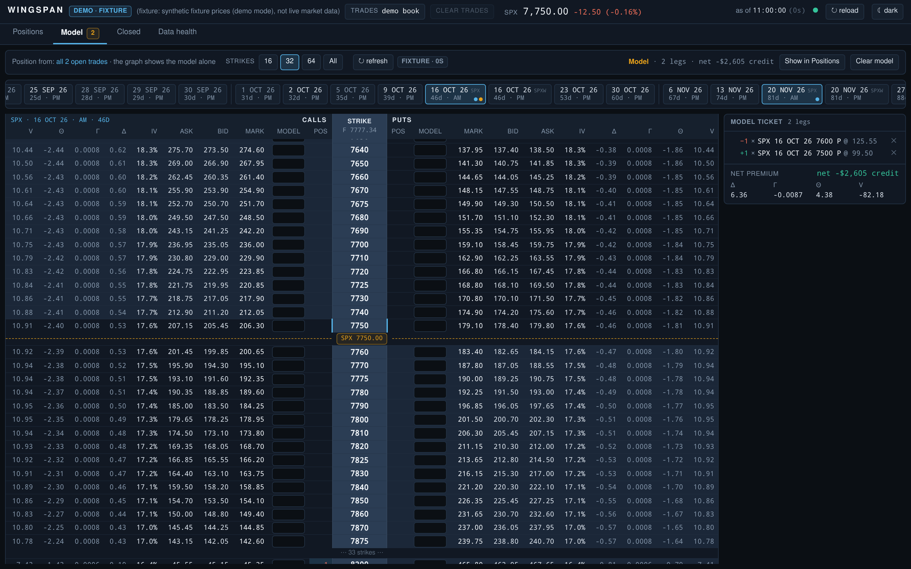

# Wingspan

**SPX options position dashboard & risk analyzer** — imports the legs of
your trades from a Google Sheet or a CSV into per-trade positions, prices
them with live (Schwab or tastytrade) or delayed (yfinance) data, and draws
an OptionNetExplorer-style risk graph. Rust core, React front end, a Tauri desktop app.

> Butterflies have wings; the risk graph spans price.

## Features

- Imports a **Legs** table (a link-shared Google Sheet tab, or a CSV with
  the same columns) into per-trade positions: butterflies, verticals,
  calendars, diagonals, ratio spreads, with fill prices and fees taken
  from the sheet's own columns. Four columns are the whole requirement
  (`Trade`, `Side`, `Qty`, `OCC Symbol`); everything else enriches the
  analysis.
- Every trade's DIT/DTE, P&L (open + realized), Greeks and weighted vega,
  toggleable in and out of a selected-subset view with live portfolio totals.
- An OptionNetExplorer-style risk graph: the expiration line plus a T+x
  ladder, breakevens, ±1σ/2σ price bands, a probability-of-profit readout
  and a what-if panel, all driven by the app's own solved IVs so the graph
  and the table always agree. Zoom 25%–500% (slider or mouse wheel) and
  drag-to-pan anywhere above price 0 — the app re-asks the model for the
  prices it now needs, tiled so a drag isn't a request per frame — and the
  y axis auto-scales to what is in view, while the header readouts stay
  honest because they are still the server's numbers over the base range
  the range mode computes, not the slice on screen. A six-row T+0 greek
  strip (P&L, Δ, Γ, Θ, vega, weighted vega) sits under the plot, sharing its
  price axis so a bar always sits under the curve sample it describes.
- A **Model** tab: the SPX option chain, OptionNetExplorer-style — calls
  left, puts right, the strike in the middle, ITM shaded and a spot line —
  with selectable expirations, the app's own solved IVs and greeks, and a
  **Pos** column showing what the trades the risk graph draws already hold.
  Type a quantity into any contract's **Model** cell and that leg joins the
  risk graph on Positions, entered at today's mark so the T+0 line at spot
  still equals the book's P&L; drag a quantity to another strike to move it
  there; one click clears the model. Modeled legs are
  scratch state in the UI, never written to the book.
- Live pricing from Schwab's market-data API — or tastytrade's, an equal
  alternative you can put first — falling back to a Yahoo (`yfinance`) bridge,
  a cached snapshot, or the latest statement's marks — each with an honest
  status pill and per-cell staleness.
- A Data Health tab that shows every warning and how to fix it.
  Quantity-only reconciliation against the latest account statement is
  available when a book has one behind it; a sheet-imported book says
  honestly that it has none.
- Closed-trades history with realized P&L, fees, win rate and average days
  held.
- A desktop app (Tauri) with the SPA embedded in its webview; dark and light
  themes.

## Install

The shipped product is a `.deb` for **Ubuntu 26.04 LTS** — download it (and
`SHA256SUMS`) from the [Releases page](https://github.com/jbolinge/wingspan/releases)
and follow `docs/DESKTOP.md` to install, verify and configure it. That is
the whole install story for a user; the rest of this section is for
building and developing Wingspan itself.

## Quick start

The shipped product is the desktop app in `web/src-tauri` (crate
`wingspan-desktop`, executable `wingspan`); `docs/DESKTOP.md` §13 covers
building and bundling it, and `docs/ARCHITECTURE.md` has the crate map.

```bash
export NVM_DIR="$HOME/.nvm" && . "$NVM_DIR/nvm.sh"   # if node is nvm-managed
just dev   # or: cd web && npm run tauri dev
```

This opens the desktop window in dev mode against Vite. On a box with no
display, see `docs/DESKTOP.md` §13 for the `xvfb-run` incantation.

With nothing configured, the first-run dialog offers **Import trades…** or
**Load demo book** — the demo book (`fixtures/demo`) is made up: a short SPX
strangle, an iron condor one expiry further out and one closed put spread,
generated by `scripts/make_demo_book.py`; nothing in it comes from an
account. It is a dated snapshot, so the demo values it on its own day
(2026-08-31) rather than yours: the DIT and DTE columns are measured from
that date, not today's calendar.

Share your tracker's **Legs** tab as anyone-with-link → Viewer and paste
the link into **Trades → Import trades…** (or the status bar's **Trade
source** control), or pick a CSV export of the same tab (add a live data
source per `docs/SCHWAB.md`/`docs/TASTYTRADE.md`/`docs/CONFIG.md` — with
none configured the dashboard waits for a market snapshot rather than
showing stale numbers). Wingspan fetches it, shows you which columns it
found **before** loading anything, and caches the last fetch so an
offline launch still shows the book, marked stale. **Clear trades** stops
showing it and deletes nothing of yours. With nothing imported and no
`[trades] sheet_url` / `csv_path` set, the dashboard simply starts empty.

## Screenshots

Dark theme, the bundled synthetic demo book. These are 1440×900 Chromium
captures of the SPA served by the dev harness (`just screenshots`), not of
the native window — the same pixels the webview draws, in a smaller frame.




## Documentation

- `docs/DESKTOP.md` — install, configure and run the desktop app
- `docs/IPC.md` — the frozen IPC contract
- `docs/CONFIG.md` — every config key
- `docs/SCHWAB.md` — token file (read-only), in-memory refresh, API usage
- `docs/TASTYTRADE.md` — the OAuth personal grant (no token file), API usage
- `docs/DATA-FORMATS.md` — the Legs table spec (and the test-only TOS grammar)
- `docs/ARCHITECTURE.md` — crate map + extension points
- `docs/DOMAIN.md` — domain rules, provider specs, the golden numbers

## Development

```bash
just ci          # the same steps CI runs — see the `ci` recipe in the justfile
just e2e         # Playwright against wingspan-devserver (embedded SPA): the test fixtures and the demo book
just bundle      # the shipped .deb: a release build with the SPA embedded
just smoke       # the built .deb's binary, driven through tauri-driver + WebKitWebDriver
just tauri-test  # the wingspan-desktop crate's own Rust tests
```

Every web recipe depends on `web-deps`, which runs `npm ci` only when
`web/node_modules` is missing or older than `web/package-lock.json` — so a
fresh clone needs no manual install step, and a warm tree runs offline with
no reinstall. `just web-install` forces the clean reinstall CI does.

The same application logic is reachable over HTTP through the dev-only
`wingspan-devserver` (always bound to `127.0.0.1`, never shipped) — that is
what the Vite dev loop proxies to and what Playwright drives. It is for
development, never for your own trades:

```bash
cd web && npm ci && npm run build && cd ..
cargo run -p wingspan-devserver --features embed-ui -- serve --demo
# then open http://127.0.0.1:8787
```

`serve --as-of YYYY-MM-DD` moves the valuation date on any run, and
`serve --legs FILE` serves another Legs CSV — `docs/CONFIG.md`.

`just e2e` starts three of these — `:8787` (the anonymised test fixtures as
`fixtures/trades/legs.csv`), `:8789` (a deliberately degraded Legs CSV — a
blank open price, a non-SPX row and a bad OCC symbol, for the degraded
states) and `:8791` (the synthetic demo book) — and reuses an already-running one on
any of those ports instead of rebuilding it (see the `reuseExistingServer` note in
`web/playwright.config.ts`). Kill any leftover `wingspan-devserver serve`
process before re-running the suite after a Rust or SPA source change, or it
will silently test the old binary.
